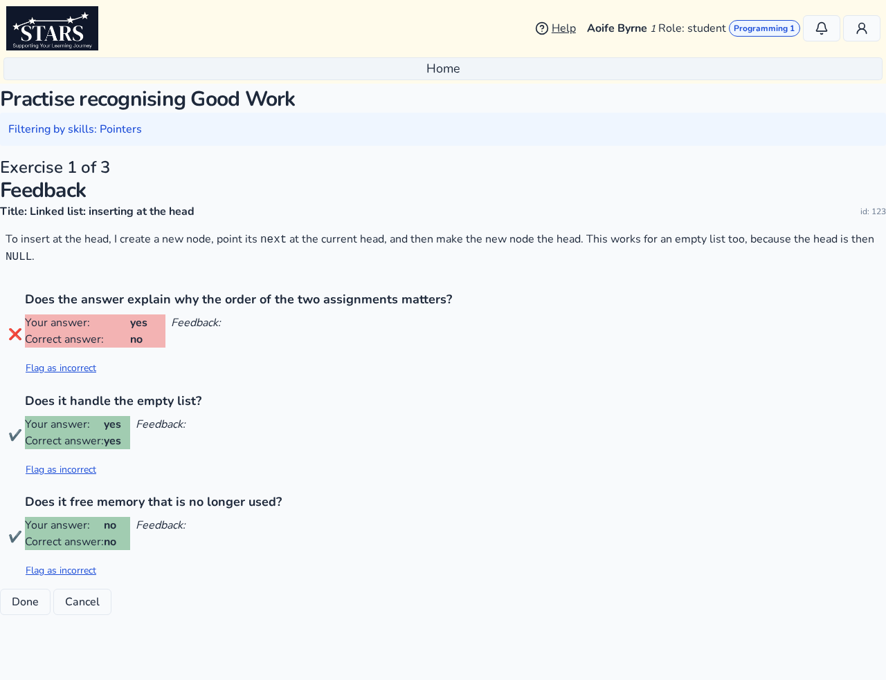

# Feedback screen

What a learner sees in Stars right after answering a practice item.

- **Exemplars**: the learner reads a piece of work and reviews it against a checklist
  (`ArtefactView`, `ArtefactReview`), then sees their answers next to the expected ones
  with feedback (`ExemplarFeedback`), then a screen asking "Are you ready for your next
  review?" before the next exemplar.
- **Exercises**: the learner answers a multiple choice or short exact answer question and
  sees the result: whether they were right, their response, the correct answer and any
  feedback.



## Run it

You need [Node.js](https://nodejs.org) 22 or later. From this folder:

```
npm install
npm run dev
```

Then open the address Vite prints (usually http://localhost:5173). `npm run build` makes a
static copy in `dist/`.

## Scenarios

- **Exemplar**: a round of three exemplars: review, feedback, "Are you ready", and on to
  the next. As in Stars, the last exemplar skips the "Are you ready" screen.
- **Exercise**: two exercises, one multiple choice and one exact answer. The result is
  part of the Stars page rather than a component, so `src/ExercisePractice.svelte` holds a
  copy of it.

The exemplars and exercises are in `src/mock/practice.js`, and the marking in
`src/mock/api.js`. The "Fill Randomly (localhost only)" button under the checklist is a
Stars test helper that appears on any localhost address.

## What is in this folder

- **`src/lib/` and `ui/`**: copies of the Stars originals: the component, the code it
  uses, and the Stars design system (the complete design tokens in
  `ui/tokens/tokens.json`, the CSS generated from them, base styles and the shared
  `Button`). They are unchanged, so the component looks and behaves as it does in Stars.
- **`src/App.svelte`** (and the other files directly in `src/`): what the Stars page does
  around the component, with the parts that are not about this screen left out. The top
  of each file says what it leaves out.
- **`src/mock/`**: stand-ins for what the component needs from the rest of Stars: the
  server (`fetch.js`, which answers from the sample data in `api.js`), the signed-in
  learner, and SvelteKit's `$app/paths` and `$app/stores`. `vite.config.js` points the
  component's imports at these. The scenario bar at the top of the page and the
  **API calls** panel at the bottom are part of the mockup, not of Stars: the panel shows
  each request the component makes and what it sends.
