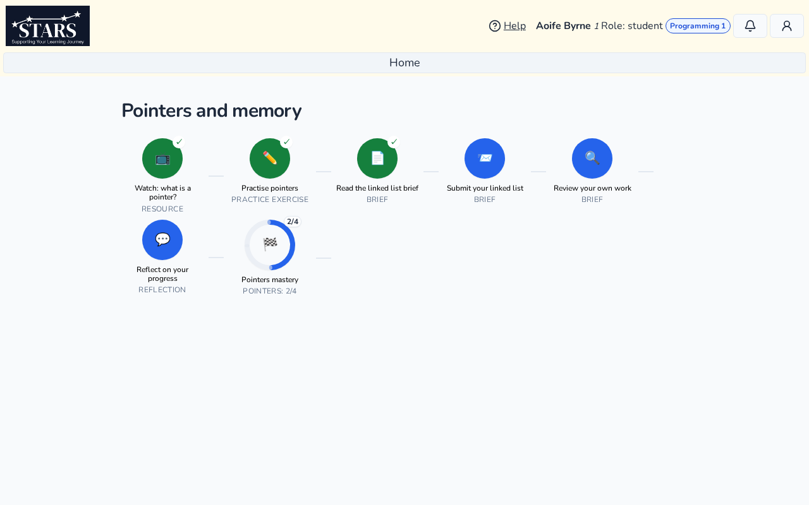

# Journey path

The map a learner sees of their learning journey in Stars (`JourneyPath.svelte`): one
round node per step, connected in rows. Each node shows the kind of step (a resource,
practice, a brief, a reflection and so on), whether it is done or locked, and a short
line about it underneath. A milestone's node is a ring split into one segment per
requirement, with its due date. Clicking a step opens it.



## Run it

You need [Node.js](https://nodejs.org) 22 or later. From this folder:

```
npm install
npm run dev
```

Then open the address Vite prints (usually http://localhost:5173). `npm run build` makes a
static copy in `dist/`.

## Scenarios

Switch between them in the bar at the top. The journeys are in `src/mock/journeys.js`.

- **Part way through**: done, in-progress and locked steps, two unread reviews, a practice
  plan that is off track, and a mastery milestone due tomorrow.
- **Just started**: nothing done yet; two steps locked until the first submission.
- **Finished**: every step done.
- **Long journey**: 15 steps over three rows, with two milestones, one of them overdue.

Clicking a locked step shows the notice Stars shows; clicking any other step shows a note
saying what Stars would open.

## Making a version of your own

The app is SvelteKit, like Stars, so each folder in `src/routes/` is a page. To try a
change next to the Stars version:

1. Copy the component and change the copy: `src/lib/components/JourneyPath.svelte` to
   `src/lib/components/JourneyPathB.svelte`.
2. Copy `src/App.svelte` to `src/AppB.svelte` and make it import `JourneyPathB`.
3. Add `src/routes/b/+page.svelte`:

   ```svelte
   <script>
   	import AppB from '../../AppB.svelte';
   </script>

   <AppB />
   ```

4. Open http://localhost:5173/b. The Stars version stays at `/`; a version C would be
   `src/routes/c/+page.svelte`.

Add new files rather than changing the Stars copies in `src/lib/` and `ui/`, so `/` keeps
showing the screen as it is in Stars, and those copies can be brought up to date from
Stars without touching your version.

## What is in this folder

- **`src/lib/` and `ui/`**: copies of the Stars originals: the component, the code it
  uses, and the Stars design system (the complete design tokens in
  `ui/tokens/tokens.json`, the CSS generated from them, base styles and every shared
  component). They are unchanged, so the component looks and behaves as it does in Stars.
  A version of your own can use any of the shared components, as Stars does:
  `import { Button, Card, Input, Modal } from '$ui/components';`
  (`ui/components/index.js` lists them all).
- **`src/routes/`**: the pages, as in any SvelteKit app. `+page.svelte` is the screen at
  `/`, and `+layout.svelte` loads the Stars global styles for every page.
- **`src/App.svelte`** (and the other files directly in `src/`): what the Stars page does
  around the component, with the parts that are not about this screen left out. The top
  of each file says what it leaves out.
- **`src/mock/`**: the sample journeys (`journeys.js`) and the scenario bar at the top of
  the page, which are part of the mockup, not of Stars. The component makes no requests
  to the server, so there is nothing else to stand in for.
