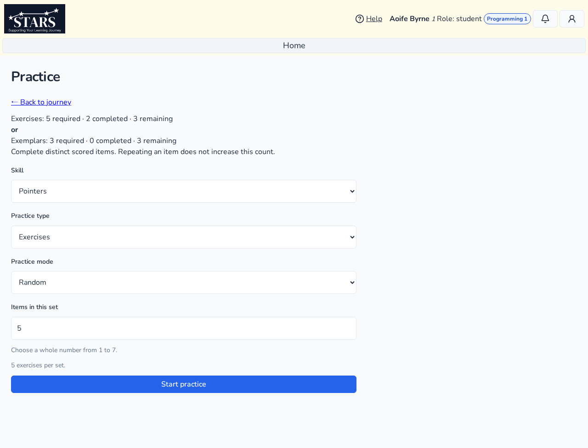

# Start practice session

The screen where a learner chooses what to practise before a practice set starts in Stars
(`PracticeEntry.svelte`): the skill, the practice type (exercises or exemplars), the
practice mode and, from a journey, how many items. When the practice is a journey step,
the step's requirements show above the choices, and the teacher may have fixed some
choices.



## Run it

You need [Node.js](https://nodejs.org) 22 or later. From this folder:

```
npm install
npm run dev
```

Then open the address Vite prints (usually http://localhost:5173). `npm run build` makes a
static copy in `dist/`.

## Scenarios

The ways a learner reaches the screen (`src/mock/scenarios.js`):

- **Journey step, the learner chooses**: exercises or exemplars, two skills, two modes and
  a set size from 1 to 7, with the step's requirements above.
- **Journey step, all set by the teacher**: every choice fixed.
- **Free practice**: opened from the menu, with every skill in the class. Arrays has no
  unseen exercises left; Recursion has too few for a set, which stops the learner
  starting.
- **A session from a practice plan**.

**Start practice** goes where Stars would; the mockup then shows that address and the
settings it carries, with a link back.

## Making a version of your own

The app is SvelteKit, like Stars, so each folder in `src/routes/` is a page. To try a
change next to the Stars version:

1. Copy the component and change the copy: `src/lib/components/PracticeEntry.svelte` to
   `src/lib/components/PracticeEntryB.svelte`.
2. Copy `src/App.svelte` to `src/AppB.svelte` and make it import `PracticeEntryB`.
3. Add `src/routes/b/+page.svelte`:

   ```svelte
   <script>
   	import AppB from '../../AppB.svelte';
   </script>

   <AppB />
   ```

4. Open http://localhost:5173/b. The Stars version stays at `/`; a version C would be
   `src/routes/c/+page.svelte`.

Add new files rather than changing the Stars copies in `src/lib/` and `ui/`, so `/` keeps
showing the screen as it is in Stars, and those copies can be brought up to date from
Stars without touching your version.

**Start practice** from `/b` shows the same note, and its link goes back to `/b`.

## What is in this folder

- **`src/lib/` and `ui/`**: copies of the Stars originals: the component, the code it
  uses, and the Stars design system (the complete design tokens in
  `ui/tokens/tokens.json`, the CSS generated from them, base styles and every shared
  component). They are unchanged, so the component looks and behaves as it does in Stars.
  A version of your own can use any of the shared components, as Stars does:
  `import { Button, Card, Input, Modal } from '$ui/components';`
  (`ui/components/index.js` lists them all).
- **`src/routes/`**: the pages, as in any SvelteKit app. `+page.svelte` is the screen at
  `/`, and `+layout.svelte` loads the Stars global styles for every page.
- **`src/App.svelte`** (and the other files directly in `src/`): what the Stars page does
  around the component, with the parts that are not about this screen left out. The top
  of each file says what it leaves out.
- **`src/mock/`**: stand-ins for what the component needs from the rest of Stars: the
  server (`fetch.js`, which answers from the sample data in `api.js`), the signed-in
  learner (`user.svelte.js`) and a Stars package (`admin-exercises.js`).
  `svelte.config.js` points the component's imports at these; a `$lib` import always
  reads from `src/lib/`, so `src/lib/fetch.js` and `src/lib/user.svelte.js` are the two
  files there that are not from Stars: they pass the import on to `src/mock/`. The
  scenario bar at the top of the page, the note shown after **Start practice** (`LeftNote`,
  at every address with no page of its own) and the **API calls** panel at the bottom are
  part of the mockup, not of Stars: the panel shows each request the component makes and
  what it sends.
